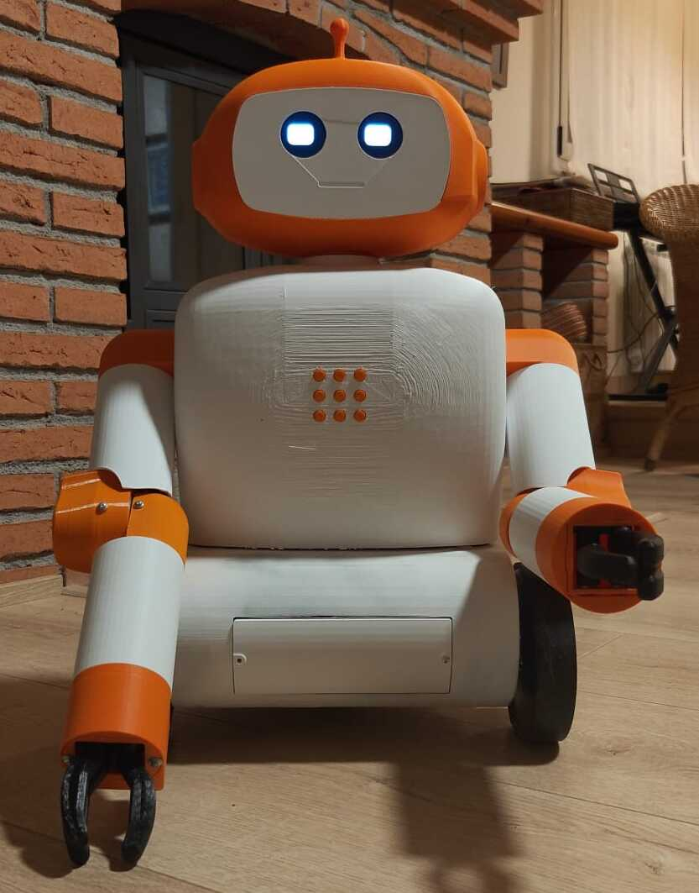

# QuiBot: robot humanoide educatiu



QuiBot és un prototip de robot humanoide orientat a la interacció educativa. Aquest repositori reuneix els fitxers mecànics, el firmware, el programari i la documentació desenvolupats durant els treballs de final de grau vinculats al projecte.

## Estructura del repositori

| Directori | Contingut |
| --- | --- |
| `hardware/Cad/` | Models mecànics i fitxers exportats en formats STEP i STL. |
| `firmware/` | Codi font executat pels microcontroladors. |
| `software/quibot/` | Programari Python executat a la Raspberry Pi. |
| `bom/` | Llista de materials i informació de compra. |
| `docs/` | Imatges i documentació complementària. |

## Requisits de programari

- Raspberry Pi OS de 64 bits i Python 3.9 o posterior.
- Arduino IDE i la biblioteca `Servo`.
- Programari CAD compatible amb fitxers STEP i STL.
- Model català de Vosk i clau de l'API d'OpenAI per executar el sistema d'interacció.

## Com començar

Per instal·lar i iniciar el programari de la Raspberry Pi:

```bash
cd software/quibot
python3 -m venv venv
./venv/bin/python -m pip install -e .
cp .env.example .env
./venv/bin/python -m robot_poc
```

Abans d'iniciar el programa cal completar el fitxer `.env` i situar el model `vosk-model-small-ca-0.4` dins de `software/quibot/models/`.

Per carregar el firmware de moviment, cal obrir `firmware/MotionController/MotionController.ino` amb l'Arduino IDE, seleccionar la placa i el port corresponents i carregar el programa.

## Llicència

Aquest projecte és Open Hardware i utilitza les llicències següents:

- **Hardware (`/hardware`):** [CERN-OHL-S-2.0](https://ohwr.org/cernohl)
- **Firmware (`/firmware`):** [MIT License](https://opensource.org/licenses/MIT)
- **Documentació (`/docs`):** [CC BY 4.0](https://creativecommons.org/licenses/by/4.0/deed.ca)

Les condicions completes es recullen al fitxer [`LICENSE`](LICENSE).

Si es reutilitza o s'adapta aquest material, es pot comunicar a [quibot@upc.edu](mailto:quibot@upc.edu) o mitjançant una *Issue* del repositori.

## Avís legal i de seguretat

- Aquest repositori i els seus materials es proporcionen tal com són, amb fins docents i de recerca.
- El dispositiu conté components elèctrics i elements mecànics en moviment. Cal aplicar les precaucions de seguretat corresponents durant el muntatge, la manipulació i l'alimentació.
- El projecte es manté en el marc de les activitats de recerca del grup RISS i no implica un compromís de suport tècnic.

## Autoria

- Investigadors principals: Marta Tarrés i Toni Dorado, Grup de Recerca RISS, Universitat Politècnica de Catalunya.
- Desenvolupament i integració TFG/TFM: Marc Llansó Alonso i Pol Camprubí Trujillo.
- Projecte finançat pel Departament d'Igualtat i Feminismes de la Generalitat de Catalunya (`IFE038/24/000087`).

Més informació: [quibot.upc.edu](https://quibot.upc.edu/).
